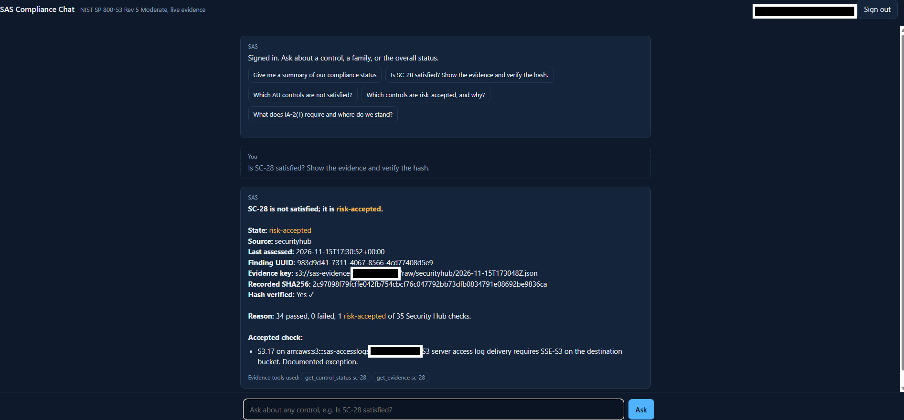
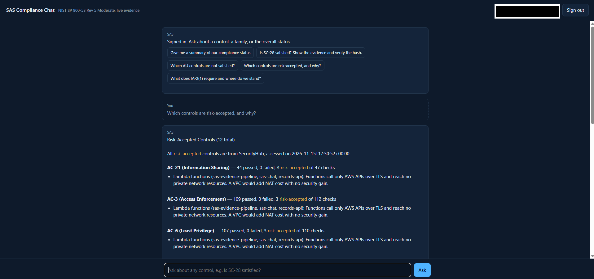
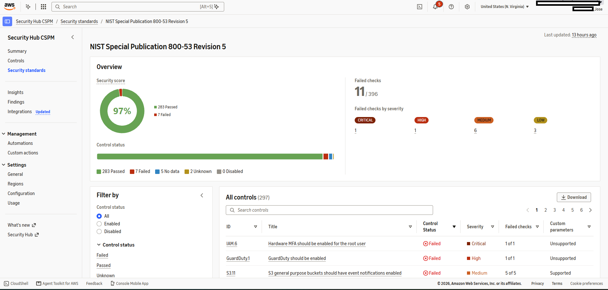
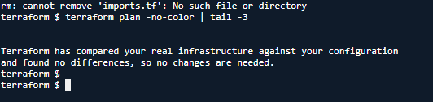
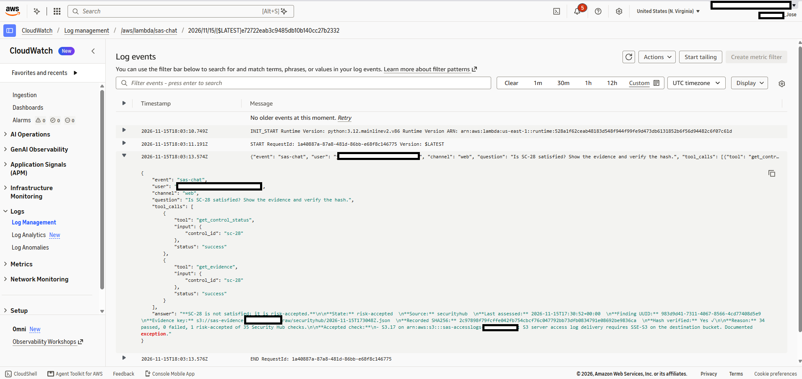
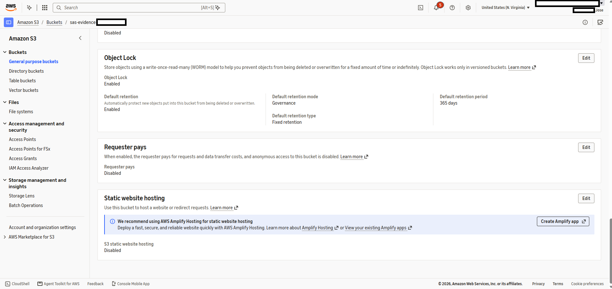
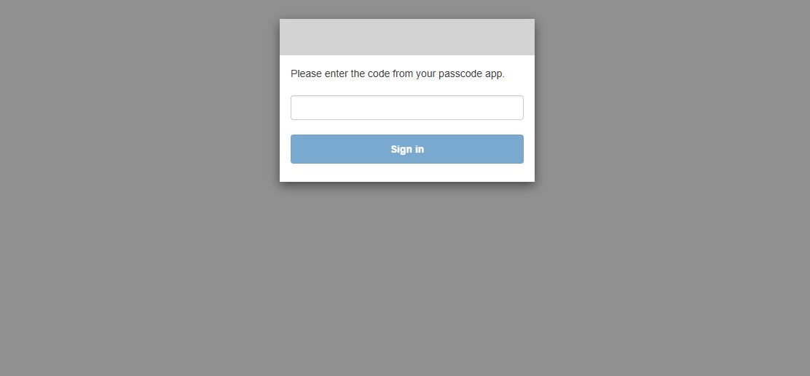
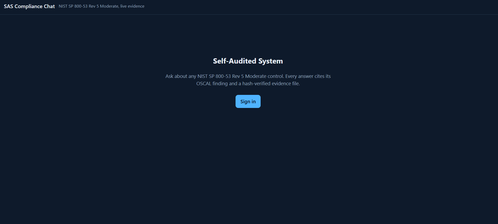
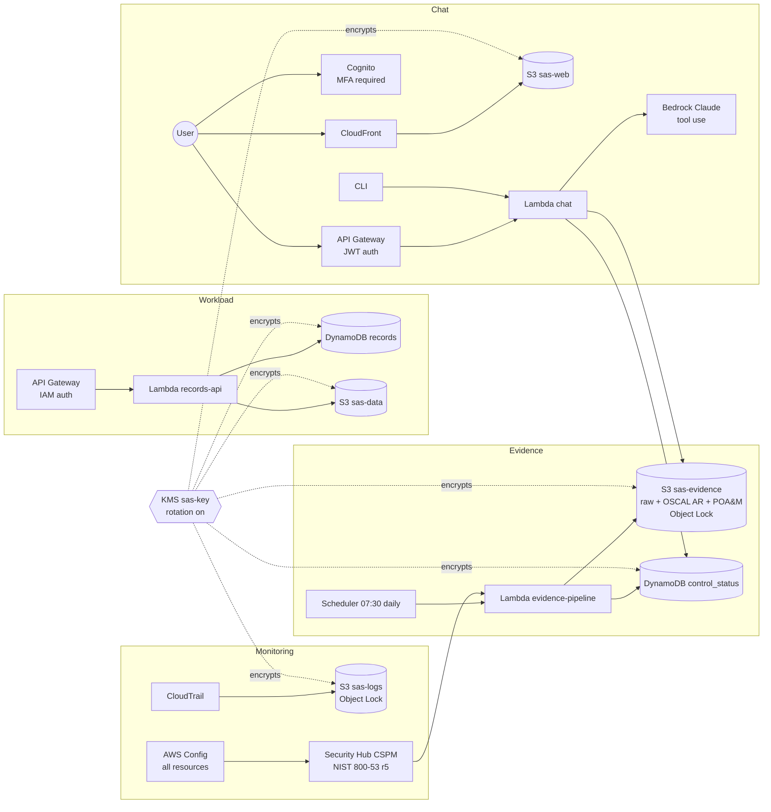

# Self-Audited System (SAS)

An AWS system that assesses itself every day against the **NIST SP 800-53 Rev 5 Moderate** baseline, writes the results as **OSCAL** with hash-verified evidence, and answers control questions through an **AI chat that can only cite that evidence**. Evidence is machine-readable, not screenshots.

> **You:** Is SC-28 satisfied? Show the evidence and verify the hash.
>
> **SAS:** SC-28 is not satisfied; it is risk-accepted. Last assessed 2026-11-15 17:30 UTC. Finding `983d9d41-...`. Evidence `s3://sas-evidence-.../raw/securityhub/2026-11-15T173048Z.json`, recorded SHA-256 `2c97898f...`, hash verified. 34 of 35 Security Hub checks passed; the accepted check is S3.17 on the access-log bucket, a documented exception.

| Evidence with a verified hash | Risk acceptances quoted from Security Hub |
| --- | --- |
|  |  |
| **Security Hub, NIST 800-53 r5 standard: 97%** | **Terraform after adopting the live account** |
|  |  |

<details>
<summary>More evidence</summary>

| Control | Screenshot |
| --- | --- |
| AU-2, AU-12: every chat question, tool call, and answer is logged with the signed-in user |  |
| AU-9: evidence bucket under Object Lock, governance mode, 365 days |  |
| IA-2(1): sign-in requires an authenticator code |  |
| AC-3: the chat is closed until you sign in through Cognito |  |

</details>

## What it does

- **Assesses all 287 Moderate controls daily** and decides a state for each: `satisfied`, `not-satisfied`, `risk-accepted`, `inherited`, or `not-assessed`. It never guesses: a control with no evidence is reported as needing manual assessment.
- **Keeps machine-readable evidence.** Raw Security Hub findings are stored unchanged with their SHA-256 under S3 Object Lock. Each run produces an OSCAL 1.1.3 assessment-results file and an OSCAL POA&M, validated against the official models.
- **Answers in plain English with citations.** The chat (Claude on Amazon Bedrock) has six read-only tools and no other access. Every answer gives the finding UUID, the evidence file, and whether the hash still matches.
- **Records risk decisions as code.** Accepted risks are Security Hub automation rules with the justification attached. The assessment reports them as `risk-accepted` and the chat quotes the reason.
- **Checks policy before deploy.** Terraform is gated by Checkov and SAS Rego rules that enforce the SSP's own parameters, each message tagged with its NIST control.

## Architecture



## Results

Two assessment runs against the full Moderate baseline, before and after one day of remediation:

| State | 2026-11-14 (first run) | 2026-11-15 | Meaning |
| --- | --- | --- | --- |
| satisfied | 18 | 26 | every mapped automated check passed |
| not-satisfied | 59 | 46 | at least one unaccepted failed check, or a missing policy attestation |
| risk-accepted | 0 | 12 | only failures are documented acceptances |
| inherited | 20 | 20 | provided by AWS (PE family, MA-2, MA-5, MP-6) |
| not-assessed | 190 | 183 | no automated check covers them yet (POA&M-09) |

Real outputs from the 2026-11-15 run, sanitized: the account ID is replaced with `111122223333` and the CloudFront distribution ID with a placeholder. The evidence hashes inside are the originals; the raw evidence they point to was deleted at teardown, so they can no longer be re-verified. [assessment results](oscal/samples/assessment-results-2026-11-15.json), [POA&M](oscal/samples/poam-2026-11-15.json).

Drift test ([docs/test-record.md](docs/test-record.md)): Block Public Access removed from a bucket was detected and recorded in **about 6 minutes**, and the fix was confirmed in **about 4 minutes**, each state preserved as a separate hash-verified evidence file.

Infrastructure as code: every resource was built by hand first, then adopted into Terraform with import blocks. After adoption, `terraform plan` reports **No changes. Your infrastructure matches the configuration.** That plan is the CM-2 baseline check.

## How a control gets its state

`src/evidence_pipeline/control-map.json` decides, in this order:

1. **Inherited** (PE family and a few others): AWS provides it; the SSP says so.
2. **Policy controls (every xx-1)**: need a dated attestation in the evidence bucket, reviewed within 365 days.
3. **Security Hub checks mapped to the control**: any unaccepted failure means `not-satisfied`; failures suppressed with a justification mean `risk-accepted`; all passing means `satisfied`.
4. **Nothing covers it**: `not-assessed`.

## Repository

| Path | Contents |
| --- | --- |
| `terraform/` | Every resource in the boundary, adopted from the live account with import blocks ([runbook](docs/terraform-adoption.md)) |
| `terraform/modules/hardened_bucket/` | One S3 baseline for all five buckets |
| `src/evidence_pipeline/` | Daily assessment: findings to evidence, OSCAL AR, POA&M, status table |
| `src/chat/` | Bedrock tool-use chat and the CLI client |
| `src/records_api/` | The workload under assessment |
| `web/` | Single-page chat with Cognito sign-in (authorization code with PKCE) |
| `oscal/` | SSP, assessment plan, NIST Moderate catalog extract, real assessment results and POA&M |
| `policy/terraform/` | SAS Rego rules and their unit tests |
| `docs/` | Risk register, POA&M, test record, Terraform adoption and teardown runbooks |
| `tools/` | SSP generator, OSCAL validator, catalog builder |
| `scripts/` | Import discovery for Terraform adoption, and the teardown script ([runbook](docs/teardown.md)) |

## CI

Every push runs: unit tests and Bandit; SSP regeneration plus OSCAL validation of SSP, AP, AR, and POA&M; `terraform fmt` and `validate`; Checkov (every skip is inline with its reason); `opa test` on the Rego rules; and `conftest` against the Terraform.

```
AU-11: log group "chat" must retain logs at least 365 days (chat.tf)
IA-5(1): IAM password policy must set require_symbols
SC-8: CloudFront "web" must force HTTPS
```

## Honest limits

- This produces evidence and status. Compliance is an assessor's determination and authorization is an authorizing official's decision.
- Security Hub's NIST mapping is AWS's interpretation of 800-53, and it covers a subset of the baseline. 190 controls still need custom checks or manual procedures.
- Built and run in a personal AWS account with synthetic data. Open weaknesses are in [docs/poam.md](docs/poam.md).

## Cost

Built on AWS Free Tier credits. The ongoing costs are Security Hub checks, Config items, one KMS key, and Bedrock tokens (Claude Haiku). With 30 or so resources, that comes to a few dollars a month.

The system ran for five days, from Veterans Day through the following Sunday, and was then torn down with [`scripts/teardown.sh`](scripts/teardown.sh), leaving the account with no ongoing charges. The [teardown runbook](docs/teardown.md) records the steps and the problems hit on the first run.
